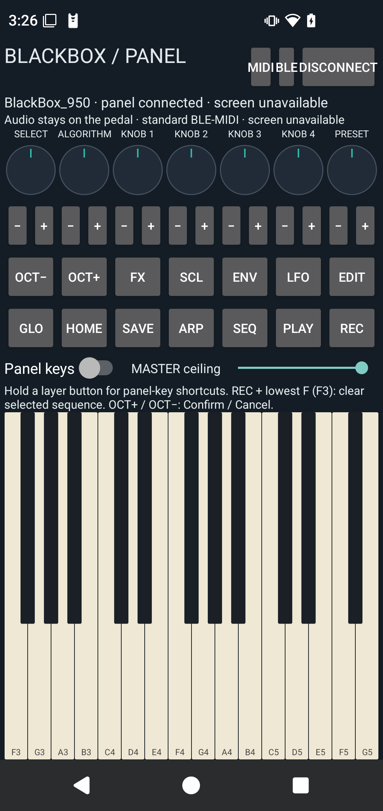

# Blackbox Companion App

An Android remote panel for [blackbox-fm1](https://github.com/guysoft/blackbox-fm1),
the independent Felucca firmware for the M-VAVE ANN Blackbox.
**The synth and audio run on the pedal, not on the phone.**



Real screenshot from the Galaxy S10e hardware session. This is the controller UI;
it does not mirror the pedal's display.

## Install and connect

Download the `*-debug.apk` from [Releases](https://github.com/guysoft/blackbox-companion-app/releases).
Until a tag is published, CI retains test APKs under Actions artifacts.
These are **experimental development-signed builds**, not Play Store/production
releases. Check `SHA256SUMS` and the signing certificate report supplied with them.

1. Install as **Blackbox Panel** (`org.guysoft.blackbox`, Android 8+).
2. Use compatible V17 community-BLE firmware from the firmware repo. This app
   does not control stock M-VAVE firmware's proprietary `ae40` protocol.
3. Keep the physical MASTER low initially. Tap **BLE**, allow Nearby Devices,
   and select your pedal, e.g. **Blackbox MIDI 8CE3**. Only one central can connect.
4. Wait for **panel connected**. Android BLE startup can take several seconds.
5. Play the keyboard or use the panel. Audio comes from the pedal's wired output.

USB MIDI also works through a phone-host/OTG connection. Plugging both phone and
pedal into a computer does not route MIDI between them.

## Controls

- 27-key keyboard, 14 holdable buttons, seven relative encoders.
- MASTER is a ceiling below the physical pot; it cannot raise physical volume.
- Normally the keyboard sends MIDI notes. Holding FX/SCL/EDIT/GLO/SEQ/REC
  temporarily sends panel keys for that layer. The Panel keys switch enables
  panel keys continuously.
- **Hold REC first, then tap the lowest F (F3)** to clear the selected track's
  sequence—not the whole song order. SAVE held is undo. This is destructive;
  do not try it on music you intend to keep.
- Routing changes release existing touches; old fingers must lift before they
  can become shortcuts. Rotation preserves the connection and releases touches.
- Leaving the app or Disconnect closes the session. Reconnect explicitly.

No parameter/display feedback, Q mini routing, Bluetooth audio or firmware update
function is included. Knob indicators show gestures, not actual parameter values.
BLE keys are held in pedal RAM; pairing may need renewal after a pedal restart.
Some older firmware has a duplicate-HELLO session bug; use the firmware fix
documented in [the release guide](https://github.com/guysoft/blackbox-fm1/blob/blackbox-fm1/docs/RELEASING.md).
The next firmware/app alpha is being prepared; the old firmware tag
`v0.1.0-alpha.1` does not contain the new BLE implementation.

## Build and test

JDK 17, Gradle **8.11.1**, Android SDK platform **35**, build-tools **35.0.0**;
Android Gradle Plugin **8.6.1**. No third-party runtime/UI dependencies.

```sh
sh test.sh
gradle :app:assembleDebug :app:lintDebug
adb install -r app/build/outputs/apk/debug/app-debug.apk
```

Host tests cover framing, identity, touch ownership, startup retry, layer routing
and lifecycle contracts. Galaxy S10e testing verified BLE HELLO/heartbeats and four
rotations without disconnect; Linux separately verified the pedal's MIDI traffic.
REC+F3 clear was deliberately not invoked on the user's music.
See [development evidence](docs/DEVELOPMENT.md).

## Development signing and releases

Version **0.2.0-alpha.1**, Android versionCode **2**. CI builds on main/PRs and
publishes only `v*` tag pre-releases, after tests/build/lint pass. Firmware has
its own release cadence/repository.

The private Actions secret `ANDROID_DEBUG_KEYSTORE_B64` supplies the existing
development signing key so experimental APK updates remain compatible. No key
is committed. Fork PRs may build with a temporary local debug key, but tags
without the maintained signing secret fail rather than publish an incompatible
APK. Development signing is not suitable for production distribution.
If you build with your own key, Android will not accept it as an in-place update
over an APK signed with another key; do not delete app data to work around that.

## Licence

GPL-3.0-only; [LICENSE](LICENSE). Original app by Guy Sheffer.
Felucca and the Blackbox research are credited in the firmware repository.
Harbor inspired the full-panel approach; no Harbor code or artwork was copied.
Screenshot is from this project's own app.
